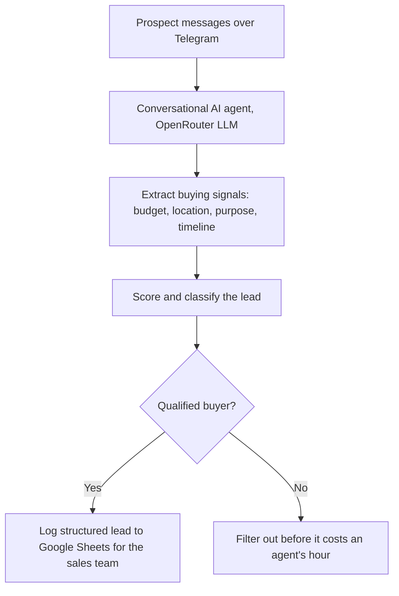

# AI Real Estate Lead Qualifier

AI lead qualification for real estate teams: it talks to inbound prospects, scores every lead, and hands sales a prioritized sheet so agents call only serious buyers.

**[Watch the demo](https://youtu.be/emWKoHsvySY)**

## The problem

Real estate agents lose hours to inquiries that never turn into deals. Most inbound leads never volunteer their budget, timeline, or intent up front, so the sales team ends up chasing everyone at the same priority. Time that should go to serious buyers gets spread thin across people who were never going to purchase.

## What it does

- Engages inbound prospects in conversation over Telegram
- Extracts the signals that matter: budget, location, purpose, timeline
- Scores and classifies each lead automatically
- Logs structured lead data to Google Sheets for the sales team, filtering out unqualified buyers before they cost an agent's hour

## Architecture

## Stack

n8n, OpenRouter (LLM), Telegram Bot API, Google Sheets.

## Workflow

| File | Role |
|---|---|
| `lead-qualification.json` | The complete qualification agent: conversation, extraction, scoring, and sheet logging |

## Import and setup

1. Import the JSON into n8n.
2. Create credentials: OpenRouter API key, Telegram bot token, Google Sheets. Credential references are name-only placeholders.
3. Replace `YOUR_SPREADSHEET_ID` with your leads sheet.

## Note on redaction

All credentials, webhook IDs, spreadsheet IDs, and phone numbers have been replaced with self-describing placeholders. The workflow logic is exactly what runs in the demo.

## License

Released under the MIT License. See [LICENSE](LICENSE).

---

Built by [Moamen Elsharkawy](https://www.linkedin.com/in/moamen--elsharkawy/), AI Automation Engineer. More builds: [portfolio](https://www.notion.so/Moamen-Elsharkawy-AI-Automation-Specialist-c201df9dd81482998591011f978b1bda) | [GitHub profile](https://github.com/Moamen-Elsharkawy)
